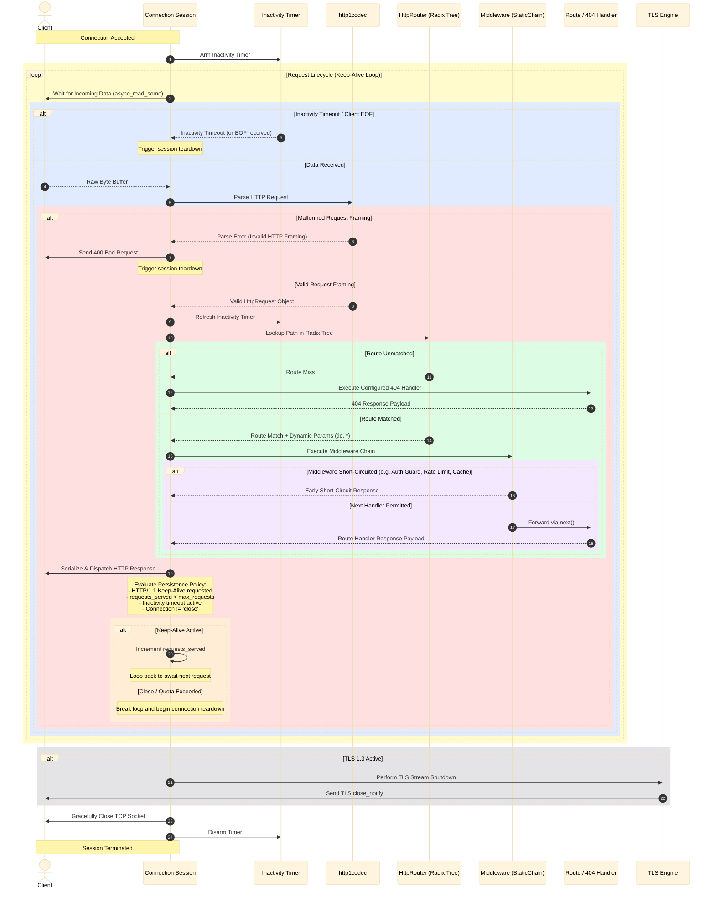

# Architecture

WaveX is a stack of small, protocol-agnostic layers. A `Server<Codec, Router>` template binds a transport, a codec and a policy; everything above the codec is shared by HTTP/1.1, HTTP/2, HTTP/3 and your own protocols.

## Design principles

- **Zero-vtable base types.** `base::Request` and `base::Response` use C++23 explicit object parameters (`this Self&& self`) instead of virtuals or CRTP.
- **Base layers never include protocol types.** `Server` and `Router` are templated on request/response types.
- **Coroutine-native.** Handlers are `asio::awaitable<void>`; middleware run in a linear, non-recursive `run_chain`.
- **Three seams.** Transport (`AsyncStream`: TCP, TLS 1.3, QUIC), Codec (`parse_stream` / `serialize`) and Policy (`protocol_traits<Codec>`).

## Runtime

Handlers run on a Tokio-inspired worker pool:

- `InlineTask<64>`: a move-only, type-erased task with a 64-byte small buffer, avoiding `std::function` allocations for coroutine continuations.
- `LocalQueue`: a bounded 256-slot ring per worker; `InjectorQueue`: an unbounded global MPMC queue for overflow and external submissions.
- A fixed-capacity atomic worker table keeps the dispatch and steal paths free of a registry mutex.
- Workers scale between `min_workers` and `max_workers` with hysteresis; retiring workers drain their local ring into the injector so queued tasks are not lost.
- Blocking and CPU-heavy work goes to a separate elastic `BlockingThreadPool` through `spawn_blocking`.

## Component map

```mermaid
flowchart TB

%% -------------------------------------------------------------
%% TIER 1: Foundations & Utilities
%% -------------------------------------------------------------
  subgraph CLI ["CLI"]
    CLIApp["Cli::CliParser<br/><small>options, flags & positionals</small>"]
  end

  subgraph Base ["Base (protocol-agnostic)"]
    direction TB
    subgraph BaseTypes ["Primitives & Memory"]
      direction TB
      Logger["Logger<br/><small>TRACE..FATAL</small>"]
      Uri["Uri / Url<br/><small>RFC 3986</small>"]
      Mime["MimeTypes<br/><small>file ext -> Content-Type</small>"]
      FlatMap["FlatMap<br/><small>inline array KV, case-insensitive</small>"]
      Memory["RequestArena<br/><small>4KB inline bump allocator</small>"]
    end

    subgraph BasePipeline ["Contracts & Pipeline"]
      direction TB
      Req["Request<br/><small>abstract (FlatMap params/query)</small>"]
      Res["Response<br/><small>fluent API (FlatMap headers)</small>"]
      Chainable["Chainable / StaticChain<br/><small>C++23 static dispatch</small>"]
      MW["Middleware<br/><small>linear chain + next()</small>"]
    end
  end

  subgraph Utils ["Utils"]
    direction TB
    TempFile["TempFileGuard<br/><small>RAII temp file</small>"]
    Multipart["MultipartFormData<br/><small>RFC 7578 + disk spooler</small>"]
    Compression["Compressor<br/><small>Gzip / Deflate</small>"]
    AsyncFs["AsyncFs (wavex::fs)<br/><small>read_file / write_file</small>"]
  end

%% Force Tier 1 to align horizontally instead of stretching down
  CLI ~~~ Base ~~~ Utils

%% -------------------------------------------------------------
%% TIER 2: Routing, Networking & Async Execution
%% -------------------------------------------------------------
  subgraph Engine ["Engine"]
    Router["Router&lt;Proto&gt;<br/><small>radix tree + RE2</small>"]
    Http1Router["Http1Router<br/><small>HTTP/1.1 routes</small>"]
    Http2Router["Http2Router<br/><small>HTTP/2 routes</small>"]
    Http3Router["Http3Router<br/><small>HTTP/3 routes</small>"]
    Router --> Http1Router & Http2Router & Http3Router
  end

  subgraph Protos ["Protos & Networking"]
    direction TB
    subgraph Codecs ["Codecs & Transport"]
      direction TB
      H1Codec["http1codec<br/><small>chunked + zero-copy</small>"]
      H2Codec["http2codec<br/><small>RFC 7540 + HPACK RFC 7541</small>"]
      H3Codec["http3codec<br/><small>RFC 9114 + QPACK RFC 9204</small>"]
      Quic["QuicStream / QUIC<br/><small>RFC 9000 & 9001 UDP engine</small>"]
    end

    subgraph ProtoIO ["Messages & Client"]
      direction TB
      HReq["HttpRequest<br/><small>Http1Request / Http2Request / Http3Request</small>"]
      HRes["HttpResponse<br/><small>Http1Response / Http2Response / Http3Response</small>"]
      Client["HttpClient<br/><small>async coroutine client</small>"]
    end
  end

  subgraph Offload ["Async & Blocking Offloading"]
    SpawnBlocking["wavex::spawn_blocking<br/><small>C++23 coroutine awaitable</small>"]
    BlockingPool["BlockingThreadPool<br/><small>elastic 2..128 ring queue</small>"]
    SpawnBlocking --> BlockingPool
  end

%% Force Tier 2 to align horizontally instead of stretching down
  Engine ~~~ Protos ~~~ Offload

%% Prevent Tier 1 and Tier 2 from breaking outward
  Base ~~~ Engine

%% -------------------------------------------------------------
%% TIER 3: Runtime & Server Core
%% -------------------------------------------------------------
  subgraph Runtime ["Tokio Dual-Queue Runtime"]
    LocalQ["LocalQueue<br/><small>256-slot lock-free ring</small>"]
    InjQ["InjectorQueue<br/><small>global MPMC overflow</small>"]
    Pool["ThreadPool<br/><small>hysteresis scaling</small>"]
    Server["Server&lt;Codec, Router&gt;<br/><small>Http1Server / Http2Server / Http3Server</small>"]
    LocalQ & InjQ --> Pool
    Pool --> Server
  end

%% -------------------------------------------------------------
%% Inter-tier Connections
%% -------------------------------------------------------------
  Req -.-> HReq
  Res -.-> HRes
  Chainable -.-> Http1Router & Http2Router & Http3Router
  MW --> Server

  AsyncFs --> SpawnBlocking
  Multipart & Compression -.-> HReq & Client

  H1Codec --> Client

  Http1Router & Http2Router & Http3Router --> Server
  H1Codec & H2Codec & H3Codec & Quic --> Server
  HReq & HRes --> Server

%% -------------------------------------------------------------
%% Classes & Theming
%% -------------------------------------------------------------
  classDef base fill:#2d6a4f,color:#fff,stroke:#1b4332;
  classDef engine fill:#1b4332,color:#fff,stroke:#081c15;
  classDef proto fill:#40916c,color:#fff,stroke:#2d6a4f;
  classDef runtime fill:#52b788,color:#000,stroke:#1b4332;

  class Logger,Uri,Mime,Chainable,FlatMap,Memory,Req,Res,MW,BlockingPool,AsyncFs,Multipart,Compression,TempFile,CLIApp base;
  class Router,Http1Router,Http2Router,Http3Router,LocalQ,InjQ engine;
  class H1Codec,H2Codec,H3Codec,Quic,HReq,HRes,Client,SpawnBlocking proto;
  class Server,Pool runtime;

%% -------------------------------------------------------------
%% Link Styles (Line Colors)
%% -------------------------------------------------------------
%% Abstract mappings (Req -> HReq, Res -> HRes) colored in bright green
  linkStyle 10 stroke:#52b788,stroke-width:2px;
  linkStyle 11 stroke:#52b788,stroke-width:2px;

%% Final routes and codecs merging into Server colored in solid blue
  linkStyle 16 stroke:#2563eb,stroke-width:2px;
  linkStyle 17 stroke:#2563eb,stroke-width:2px;
  linkStyle 18 stroke:#2563eb,stroke-width:2px;
  linkStyle 19 stroke:#2563eb,stroke-width:2px;
  linkStyle 20 stroke:#2563eb,stroke-width:2px;

```

## Request lifecycle

The sequence below follows one HTTP/1.1 connection: accept, keep-alive loop, parse, route, middleware, serialize, persistence decision and teardown.

---

**See also:** [Custom protocols](guides/custom-protocols.md) · [Memory & lifetimes](guides/memory-and-lifetimes.md) · [Component status](components.md)
