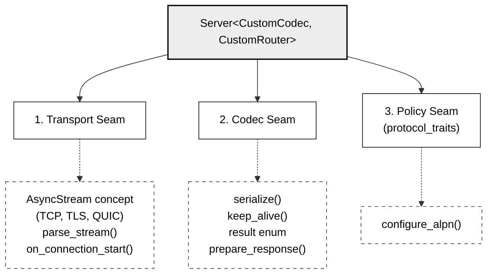

# Custom Protocols (3-Seam Guide)

Plug a new wire protocol (RPC, Redis-like, IoT) into the same runtime, connection tracker and TCP/TLS/QUIC transports by providing a codec, protocol traits and a router.

WaveX is architected around a strict **3-Seam Foundation**, making it completely protocol-agnostic. You can implement custom binary protocols, line-based RPCs, database interfaces (e.g. Redis, Memcached), or IoT message transports with zero changes to the underlying Tokio work-stealing runtime, connection tracker, or TCP/TLS/QUIC network engine.



---

## Step 1: Define Custom Request & Response Types (C++23 "Deducing This")

Derive directly from `wavex::base::Request` and `wavex::base::Response`. The base classes use C++23 explicit object parameters (`this Self&& self`) to provide zero-vtable polymorphism without CRTP template boilerplate:

```c++
#include <wavex/Base/Request.hpp>
#include <wavex/Base/Response.hpp>
#include <string>
#include <string_view>

class MyRequest final : public wavex::base::Request {
private:
    std::string command_{};
    std::string argument_{};
    std::size_t consumed_bytes_{0};

public:
    MyRequest() = default;

    // Protocol-specific getters/setters
    [[nodiscard]] std::string_view command() const noexcept { return command_; }
    [[nodiscard]] std::string_view argument() const noexcept { return argument_; }
    [[nodiscard]] std::size_t consumed_bytes() const noexcept { return consumed_bytes_; }

    void set_command(std::string cmd) { command_ = std::move(cmd); }
    void set_argument(std::string arg) { argument_ = std::move(arg); }
    void set_consumed_bytes(std::size_t n) noexcept { consumed_bytes_ = n; }

    // C++23 deducing-this base class customization points
    [[nodiscard]] std::string_view path_impl() const noexcept { return command_; }
    [[nodiscard]] std::string_view body_impl() const noexcept { return argument_; }
    [[nodiscard]] std::string_view header_impl(std::string_view) const noexcept { return {}; }
};

class MyResponse final : public wavex::base::Response {
private:
    std::string payload_{};

public:
    MyResponse() = default;

    // Fluent API
    MyResponse& reply(std::string data) {
        payload_ = std::move(data);
        this->is_sent_ = true; // Signals commitment to the pipeline
        return *this;
    }

    // C++23 deducing-this base class customization points
    [[nodiscard]] std::string serialize_impl() const {
        return "+" + payload_ + "\r\n";
    }

    decltype(auto) send_impl(std::string_view data) {
        return reply(std::string(data));
    }
};
```

---

## Step 2: Implement the Protocol Codec (`CustomCodec`)

The Codec defines message types, binary/text framing, wire serialization, and parsing state:

```c++
struct MyCodec {
    using request_type = MyRequest;
    using response_type = MyResponse;

    enum class result {
        complete,     // Full framing parsed successfully
        incomplete,   // Partial frame, need more bytes from socket
        error         // Malformed framing, connection should terminate
    };

    static result parse_stream(std::string_view buffer, request_type &req) {
        auto newline_pos = buffer.find("\r\n");
        if (newline_pos == std::string_view::npos) {
            return result::incomplete; // Wait for full line
        }

        std::string_view line = buffer.substr(0, newline_pos);
        req.set_consumed_bytes(newline_pos + 2); // Consumes trailing \r\n

        auto space_pos = line.find(' ');
        if (space_pos == std::string_view::npos) {
            req.set_command(std::string(line));
            req.set_argument("");
        } else {
            req.set_command(std::string(line.substr(0, space_pos)));
            req.set_argument(std::string(line.substr(space_pos + 1)));
        }

        // Set path for Router resolution
        req.set_path("/" + std::string(req.command()));
        return result::complete;
    }

    static std::string serialize(const response_type &res) {
        return res.serialize();
    }

    static std::string_view status_text_for(int code) noexcept {
        return (code == 200) ? "OK" : "ERR";
    }
};
```

---

## Step 3: Specialize Protocol Traits (`protocol_traits<CustomCodec>`)

Specialize `wavex::protos::protocol_traits` to specify connection lifetime policies, handshake prefaces, and transport parameters:

```c++
#include <wavex/protos/ProtocolTraits.hpp>

namespace wavex::protos {

    template<>
    struct protocol_traits<MyCodec> {
        // Transport capabilities
        static constexpr bool has_connection_preface = false; // Set true for protocols with magic prefaces (e.g. HTTP/2)
        static constexpr bool has_tcp_transport = true;       // Enables TCP listener
        static constexpr bool has_quic_transport = false;     // Set true for native QUIC UDP transport

        // Called immediately on socket connect (for preface exchange/handshake)
        template<typename Stream>
        static asio::awaitable<bool> on_connection_start(Stream &, std::string &) {
            co_return true;
        }

        // Keep-alive evaluation for persistent connections
        static bool keep_alive(const MyRequest &, unsigned current_requests, unsigned max_requests) noexcept {
            return current_requests < max_requests;
        }

        // Response preparation & protocol header injection
        static void prepare_response(const MyRequest &, MyResponse &,
                                     bool /*keep_alive*/, unsigned /*timeout_sec*/,
                                     unsigned /*remaining_requests*/,
                                     unsigned short /*alt_svc_port*/ = 0) noexcept {
            // Attach any protocol-level trailing headers or framing if required
        }

        // ALPN configuration for TLS negotiation (optional)
        static void configure_alpn(void */*ssl_ctx*/) noexcept {}
    };

} // namespace wavex::protos
```

---

## Step 4: Create the Router Specialization (`CustomRouter`)

You can use the general `wavex::engine::Router<MyCodec>` or build a domain-specific router with custom convenience methods:

```c++
#include <wavex/Engine/Router.hpp>

class MyRouter : public wavex::engine::Router<MyCodec> {
public:
    using Handler = std::function<asio::awaitable<void>(MyRequest &, MyResponse &)>;

    static MyRouter &instance() {
        static MyRouter r;
        return r;
    }

    void command(std::string_view cmd, Handler h) {
        // Register under radix tree with leading slash
        this->add_route(wavex::protos::http::method::GET, "/" + std::string(cmd), {}, std::move(h));
    }
};
```

---

## Step 5: Complete Self-Contained Working Example

Here is a complete, runnable Redis-like key-value store server using your custom protocol:

```c++
#include <wavex/wavex.hpp>
#include <unordered_map>

// Shared in-memory database
std::unordered_map<std::string, std::string> g_kv_store;

int main() {
    auto &router = MyRouter::instance();

    // 1. PING command -> replies PONG
    router.command("PING", [](MyRequest &, MyResponse &res) -> asio::awaitable<void> {
        res.reply("PONG");
        co_return;
    });

    // 2. SET command (argument: "key=value")
    router.command("SET", [](MyRequest &req, MyResponse &res) -> asio::awaitable<void> {
        auto arg = req.argument();
        auto eq = arg.find('=');
        if (eq == std::string_view::npos) {
            res.reply("ERR syntax error, expected key=value");
            co_return;
        }
        std::string key(arg.substr(0, eq));
        std::string val(arg.substr(eq + 1));
        g_kv_store[key] = val;
        res.reply("OK");
        co_return;
    });

    // 3. GET command (argument: "key")
    router.command("GET", [](MyRequest &req, MyResponse &res) -> asio::awaitable<void> {
        std::string key(req.argument());
        if (auto it = g_kv_store.find(key); it != g_kv_store.end()) {
            res.reply(it->second);
        } else {
            res.reply("(nil)");
        }
        co_return;
    });

    // Run Server with your custom Codec and Router on port 6379
    wavex::server::Server<MyCodec, MyRouter> server(router, "127.0.0.1", 6379);
    wavex::log::info("Custom Key-Value server running on 127.0.0.1:6379");
    server.run();

    return 0;
}
```

```bash
# Test with netcat or telnet:
nc 127.0.0.1 6379
PING
+PONG
SET name=WaveX
+OK
GET name
+WaveX
```

---

**See also:** [Architecture](../architecture.md) · [3-seam reference for contributors](../../.agents/skills/wavex-development/references/three-seam-architecture.md)
